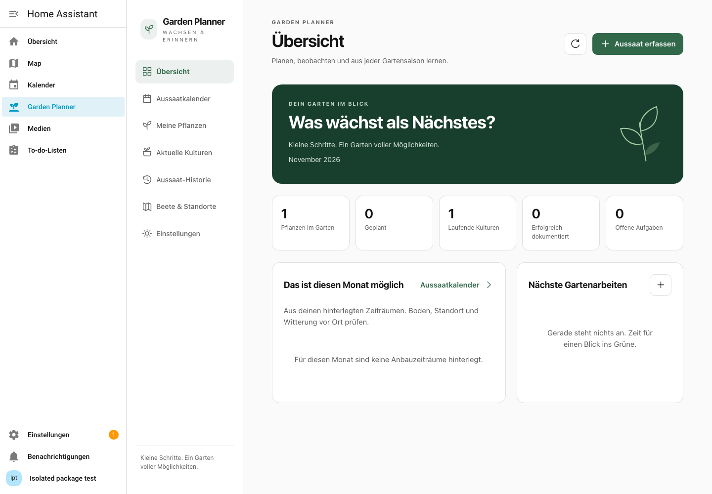

# Garden Planner


**Deutsch** · [English](docs/en/README.md)

Lokaler Aussaat-, Pflanz-, Pflege- und Erntekalender für Home Assistant.

**Öffentliche Entwicklungsversion: [v0.1.0](https://github.com/ClamsyHub/ha-garden-planner/releases/tag/v0.1.0).**
Automatisches Seitenleisten-Panel, Live-Temperaturen, Sensor-/Kalender-Entitäten,
Bearbeitungsfreigaben und optionale Erinnerungen sind vorhanden. Dies ist eine
Vorabversion, noch keine stabile Version 1.0.

Quellcode: [ClamsyHub/ha-garden-planner](https://github.com/ClamsyHub/ha-garden-planner).
Die erste Entwicklungsversion ist veröffentlicht und als Custom Repository
in HACS und Marketplace getestet. Keine Aufnahme in den
offiziellen Katalog. Live-Verzeichnisse werden nicht zur Entwicklung verwendet.

## Oberfläche



Eine zusammenhängende Anwendung mit sieben Bereichen:

1. **Übersicht:** hinterlegte Anbauzeiträume des aktuellen Monats, Aufgaben und Kennzahlen.
2. **Aussaatkalender:** Monat, Woche und Jahresbalken mit Tagesgrenzen, Filtern und Pflanzendetails.
3. **Meine Pflanzen:** Stammdaten, Sorten, mehrere Zeitfenster, Suche, Sortierung, Duplizieren und Archivieren.
4. **Aktuelle Kulturen:** Aussaat erfassen, bearbeiten und datierte Ereignisse dokumentieren; Aufgaben erledigen.
5. **Aussaat-Historie:** tatsächliche Aussaattermine und Ergebnisse über mehrere Jahre vergleichen.
6. **Beete & Standorte:** Standorte verwalten, optional Temperatursensor und Messart zuordnen.
7. **Einstellungen:** Sprache, Bearbeitungsrechte, optionale Erinnerungen, JSON-/CSV-Export, Importvorschau und Sicherungen.

Deutsch und Englisch, Hell-/Dunkelmodus, Smartphone-/Tablet-/Desktop-Layout,
native zugängliche Dialoge, Tastaturbedienung und übersetzte Fehlerzustände.
Es gibt keine vorinstallierten Pflanzenempfehlungen. Alle Kalenderangaben stammen
aus eigenen Datensätzen; Quellen und regionale Hinweise bleiben bearbeitbar.

[Screenshots und Bedienung](docs/frontend.md) · [Prüfergebnisse](docs/validation.md)

## Lokale Speicherung

Pflanzen, Sorten, Anbauzeitfenster, Beete, Aussaaten, Ereignisse und Aufgaben werden
in SQLite auf einem eigenen Worker gespeichert. Wiederholte Aussaaten und
mehrjährige Historie bleiben erhalten. Historische Momentaufnahmen schützen den
Kontext einer Aussaat vor späteren Stammdatenänderungen. Revisionen verhindern
stilles Überschreiben paralleler Bearbeitungen und alter Formulare nach Restore.

JSON und strukturierte CSV-Tabellen erhalten IDs und Beziehungen. Die Oberfläche
packt CSV-Tabellen als ZIP. Ersetzungsimport und Restore erfordern Vorschau und
Bestätigung; vorher wird eine konsistente Sicherung erstellt. Programmcode und
Nutzerdaten liegen getrennt. Details: [Backend/API](docs/backend.md).

## Voraussetzungen und Installation

Sicherheitsminimum: Home Assistant **ab 2026.7.0**, einschließlich Container und anderer
unterstützter Installationsarten. Keine zusätzlichen Container, Cloud-Dienste oder
HACS-Karten. Das fertige Frontend liegt bereits im Integrationspaket; Nutzer werden
weder Node.js noch einen eigenen Build benötigen.

Die Integration registriert das Panel automatisch; YAML und zusätzliche
Frontend-Ressourcen sind nicht erforderlich. Eine vollständige Einrichtung wurde
in einem separaten offiziellen HA-Container getestet. Für eigene Tests nur eine
isolierte Instanz verwenden. Installation und erneuter Download des veröffentlichten Pakets wurden mit HACS
und Marketplace in separaten HA-Containern getestet. Die lokale Vorschau verwendet einen
separaten Testadapter mit ausschließlich temporären Daten.

[Installation](docs/de/README.md) · [Lokale Vorschau](docs/frontend.md)

**Sicherheit:** HA vor 2026.7.0 enthält die kritische XSS-Lücke
[CVE-2026-91130](https://github.com/advisories/GHSA-wx4m-69m9-gx3m).
Die alte HA-2026.6-Testabhängigkeit wurde entfernt. Das höhere Minimum gilt für
den aktuellen Entwicklungsstand; veröffentlichte v0.1.0-Dateien werden nicht
nachträglich verändert. [Details](docs/security/CVE-2026-91130.md).

## Entwicklung und Prüfungen

Python >=3.14.2, Node.js >=22.12 (CI: Node 24), jeweils in einer isolierten Umgebung.

```sh
python3 -m venv .venv
source .venv/bin/activate
python -m pip install -e '.[dev,ha-test]'
python scripts/check_repository.py
python -B -W error::ResourceWarning -m unittest discover -s tests -v
python -B -W error::ResourceWarning -m unittest discover -s ha_tests -v
ruff check .
ruff format --check .
mypy
```

Frontend aus `frontend/`:

```sh
npm ci --ignore-scripts
npm run typecheck
npm run format:check
npm test
npm run check:bundle
npx playwright install chromium webkit
npm run test:e2e
```

`check:bundle` baut neu und vergleicht JavaScript sowie Lizenzhinweise bytegenau
mit den vorhandenen Auslieferungsdateien. Änderungen zuerst bewusst mit
`npm run build` übernehmen. Browserprüfungen starten einen lokalen Python-
Testadapter und verwenden echte temporäre SQLite-Datenbanken. Kein Zugriff auf
produktive HA-Konfigurationen oder private Testdaten.

## Noch offen vor einem stabilen Release

Versionswechsel beim nächsten Release, weitere Praxis-/Gerätetests und die
gesondert freizugebende Katalogaufnahme. GitHub-Veröffentlichung und erste
Custom-Repository-Installation sind abgeschlossen: [Veröffentlichungsnachweis](docs/publication.md).
Die [Release-Checkliste](docs/releasing.md) bleibt für weitere Versionen verbindlich.
Administratoren bearbeiten und verwalten Freigaben; weitere aktive HA-Nutzer
lesen den gemeinsamen Garten. Erinnerungen sind standardmäßig ausgeschaltet.
Ihre Aktivierung erfordert einen vorhandenen HA-Benachrichtigungskanal.
Details zu Versandversuchen, Sensoren und Datensicherung: [Betrieb](docs/de/README.md).

## Dokumentation und Lizenz

[Architektur](docs/architecture.md) · [Roadmap](docs/roadmap.md) ·
[Veröffentlichung](docs/releasing.md) · [Abhängigkeiten](docs/dependencies.md) ·
[Mitwirken](CONTRIBUTING.md) · [Sicherheit](SECURITY.md) · [Changelog](CHANGELOG.md)

Projektcode: [MIT](LICENSE). Mitgelieferte Bibliotheken behalten ihre eigenen
Lizenzen; [vollständige Laufzeit-Lizenzhinweise](docs/THIRD_PARTY_NOTICES.txt) werden
zusammen mit dem JavaScript-Paket ausgeliefert.
