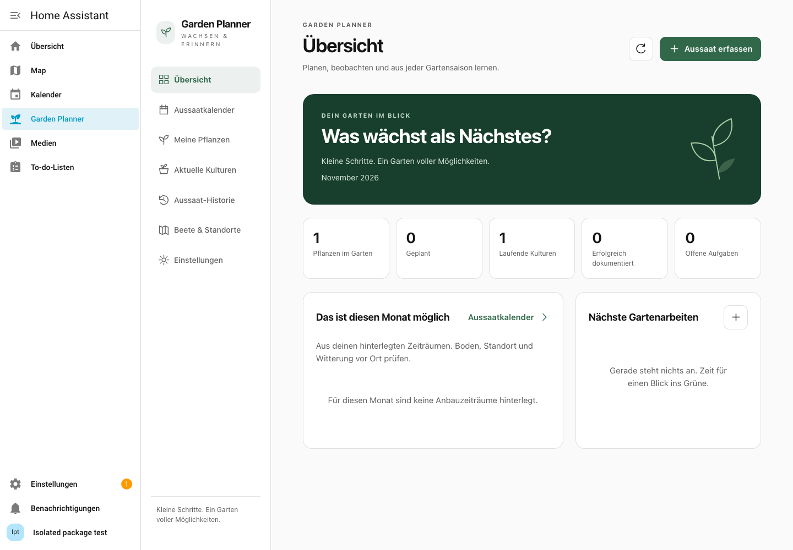
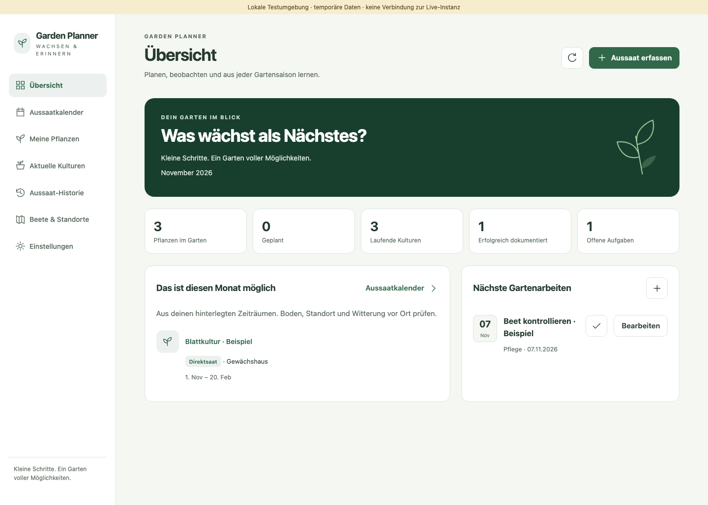
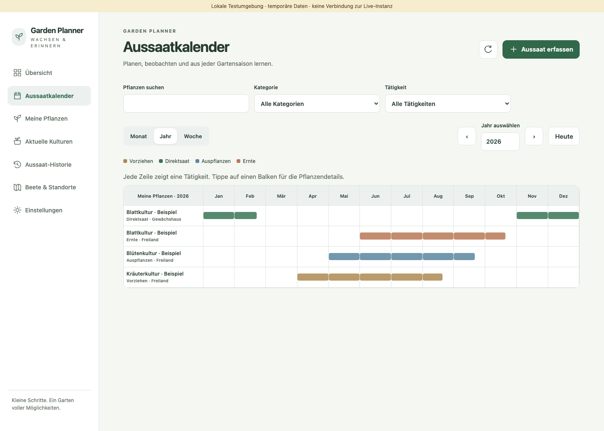
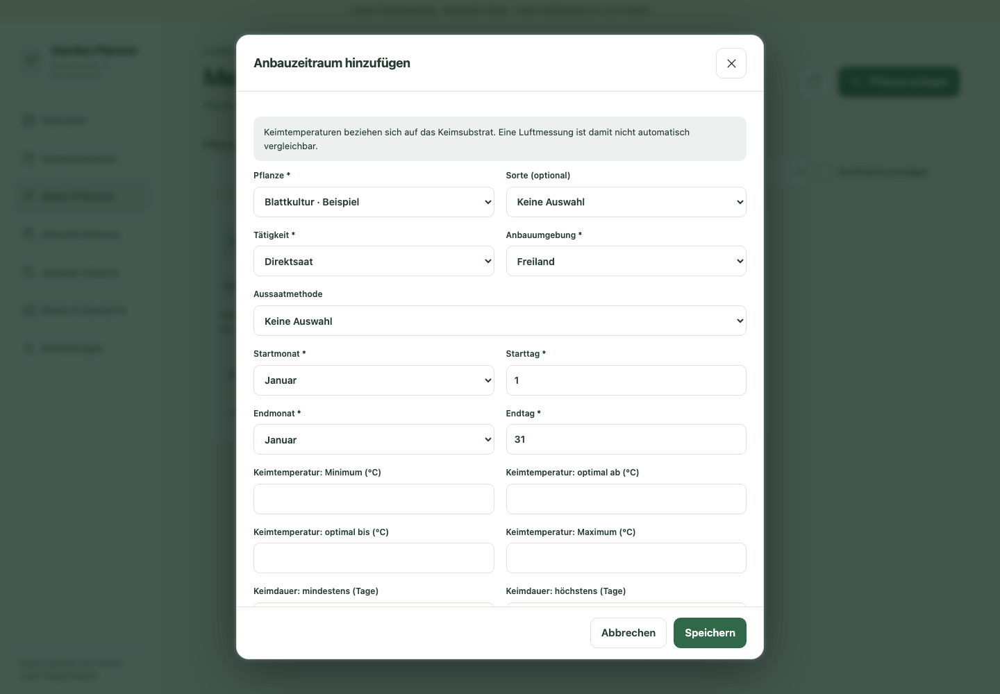
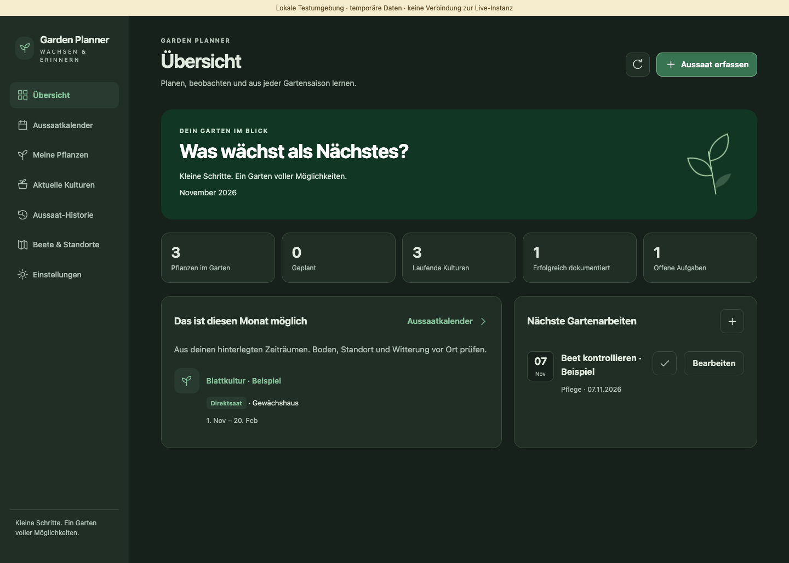

# Oberfläche und lokale Vorschau / Frontend and local preview

## Stand und Grenzen / Status and boundaries

Das gebaute Web Component `garden-planner-panel` implementiert die sieben
Anwendungsbereiche. Ein HA-Host übergibt seine vorhandene `hass`-Verbindung und
optional `narrow`. Es werden keine Zugangstokens gespeichert oder selbst erzeugt.
Die Integration registriert das Panel beim Einrichten automatisch. Der lokale Testadapter
ist keine HA-Authentifizierung und wird nicht mit der Integration ausgeliefert.

The compiled `garden-planner-panel` uses an existing authenticated HA connection.
Automatic panel registration, live temperature integration and opt-in reminders
are implemented. The loopback development bridge has synthetic identities and is
not shipped inside the integration. Never expose it on a public network or point
it at a production data directory.

## Native Home-Assistant-Oberfläche

Nach Installation des öffentlichen v0.1.0-Pakets im echten HA-Frontend aufgenommen.
Ausschließlich synthetische Daten und temporäre Testkonten.



[HACS / HA 2026.6](screenshots/native-legacy.png) · [Installationsnachweis](publication.md)

## Screenshots

Tatsächliche Screenshots des gebauten Frontends aus den Browserprüfungen.
Alle sichtbaren Datensätze sind ausdrücklich synthetisch und keine gärtnerischen
Empfehlungen. Keine privaten Konfigurationen oder realen Gartenaufzeichnungen.

Actual compiled-frontend screenshots, with synthetic test records only.









[Smartphone – Hellmodus](screenshots/overview-mobile-light.png) ·
[Smartphone – Dunkelmodus](screenshots/overview-mobile-dark.png)

## Vorschau starten / Start a local preview

Python >=3.14.2 and Node >=22.12. From the repository root, prepare the bundle:

```sh
cd frontend
npm ci --ignore-scripts
npm run build
```

Terminal 1, from the repository root:

```sh
python3 -m scripts.browser_test_server
```

Terminal 2, from `frontend/`:

```sh
npm run dev
```

Open `http://127.0.0.1:5173/` for an empty garden. The explicit `?demo=1` option
creates synthetic records in this **test server only**. Add `&dark=1` to preview a
dark HA theme, `&host=1` for synthetic settings controls (no real notifications),
or `&role=reader` to preview read-only access. A session can be kept
within the current server run using `&session=my-test-session`. All test data lives
in temporary directories and is removed when the server shuts down normally.
These records are not a durable personal garden. Stop both terminals with Ctrl+C.

Die Vorschau bleibt auf 127.0.0.1. Niemals produktive Daten importieren oder den
Testserver ins Netzwerk freigeben. Die Schaltfläche zur Sprachwahl speichert nur
eine Browserpräferenz; Fachdaten gehören weiterhin ins Backend.

## Bedienung – Deutsch

- **Pflanze anlegen:** Name und optionale Stammdaten eingeben. Im Detail Sorten
  und beliebig viele Anbauzeitfenster ergänzen. Jedes Fenster hat Tätigkeit,
  Umgebung, eigene Tagesgrenzen und optionale Keim-/Quellenangaben.
- **Kalender:** Monat, Woche oder Jahr auswählen. Monats-/Jahresansichten zeigen
  gepflegte Zeitfenster; die Woche zeigt konkrete Aufgaben und dokumentierte
  Ereignisse. Jahresbalken berücksichtigen Teilmonate und den Jahreswechsel.
  Balken oder Pflanzennamen öffnen die Details. Kategorien, Tätigkeiten und Suche
  filtern die Ansichten. Im Smartphone-Jahresplan horizontal wischen.
- **Aussaat erfassen:** Pflanze, Datum (heute in der HA-Zeitzone), Methode und
  optional Beet, Sorte, Menge, Messwert und Notiz eingeben. Für einen Messwert
  muss die Messart angegeben werden. Eine geplante Kultur wird ausdrücklich als
  geplant angelegt; erst ein Ausgesät-Ereignis dokumentiert die tatsächliche Aussaat.
- **Kulturverlauf:** datierte Ereignisse und Notizen ergänzen oder bearbeiten.
  Das erste Datum/der erste Status wird über die Aussaat bearbeitet. Das Ergebnis
  ist eine eigene Beobachtung, kein aus dem Status berechneter Erfolg.
- **Historie:** nach Pflanze und Jahr filtern; Einträge öffnen den vollständigen
  Verlauf. Die ausklappbare Momentaufnahme zeigt Stammdaten, Sorte, Standort und
  Zeitfenster zum Zeitpunkt der Erfassung.
- **Standorte:** auch ohne Sensor nutzbar. Sensor-ID und Messart können gespeichert
  werden; verfügbare Livewerte werden angezeigt (°C/°F/K werden umgerechnet). Lufttemperatur ist
  kein Ersatz für eine Messung des Keimsubstrats.
- **Aufgaben:** auf Übersicht oder bei aktuellen Kulturen anlegen, bearbeiten und
  abhaken. Der Wochenkalender zeigt sie an ihren konkreten Terminen.
- **Sicherheit:** Löschen verlangt eine Rückfrage. Verknüpfte Datensätze können die
  Aktion verhindern. Bei einem Konflikt bleiben offene Formulare erhalten; den
  aktuellen Stand prüfen, bevor erneut gespeichert wird. Ein fehlgeschlagener
  Schreibvorgang wird nicht als Erfolg angezeigt.

## Import und Sicherung / Import and backup

Administratoren können JSON oder ein ZIP mit den sieben strukturierten CSV-Dateien
plus `metadata.json` exportieren. Die Datei wird beim Import anhand ihres Inhalts
erkannt. Der Import prüft den Datensatz zuerst und zeigt Änderungen, Konflikte und
Löschungen. Zusammenführen überschreibt keine abweichenden Datensätze. Ersetzen
benötigt ein zusätzliches Bestätigungshäkchen. Restore einer verwalteten Sicherung
verwendet denselben geprüften Ablauf. Eine zwischenzeitliche Datenänderung macht
eine alte Vorschau ungültig. Backups bleiben lokal, unverschlüsselt und werden
nicht automatisch gelöscht.

The UI packages the backend's typed CSV cells into ZIP; do not remove their JSON
quoting when editing them. Limits: 20 MiB input/uncompressed CSV and the backend's
50,000-record limit. In HA, large list/history and file transfers use an authenticated
HTTP endpoint with a bounded 41 MiB JSON envelope (20 MiB document/CSV limits still apply). Use a fresh preview after conflicts.
Malformed/unknown-path/duplicate-entry CSV archives are rejected. File imports
never automatically enable notifications or modify Home Assistant settings.

## Technik und Tests / Engineering and testing

Lit + TypeScript; Vite library build, one self-contained ES module, no CDN imports.
Native forms and dialog focus handling; all user text is escaped through Lit.
Date arithmetic uses gardening dates at UTC noon, with the HA timezone used for
"today"; seasonal windows are never shifted by daylight-saving changes.
HA state-object updates do not repeatedly subscribe to the backend. Reconnect
refreshes records; disconnect removes listeners/subscriptions. User/connection
changes discard the prior host's cached records. Test actors never enter the bundle.

Vitest exercises date/window/form/ZIP/error contracts. Playwright exercises the
actual compiled bundle against real PlannerService/SQLite through a loopback-only
bridge, on desktop Chromium, mobile Chromium and WebKit. Axe checks both themes
and open forms without disabling rules. Screenshots document actual rendering.
These harness checks are not physical-device or Companion App tests. Actual
public-package HA installation evidence is in [publication](publication.md).
